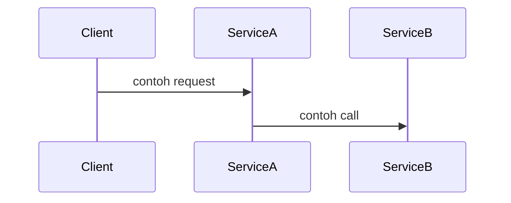

# [Judul Singkat & Jelas] Design Doc

| | |
|---|---|
| **Status** | Draft / In Review / Approved / Implemented / Deprecated |
| **Author(s)** | Nama (email) |
| **Reviewer(s)** | Nama (email) |
| **Tanggal Dibuat** | YYYY-MM-DD |
| **Terakhir Diupdate** | YYYY-MM-DD |
| **Service Terkait** | mis. `services/course`, `libs/<shared-lib>` |
| **Ticket / Issue** | link ke Jira/GitLab issue |

> Hapus baris ini setelah dibaca: dokumen ini menjelaskan **apa** yang akan dibangun dan **kenapa**, bukan detail implementasi baris demi baris. Kalau perubahannya kecil dan tidak berisiko, kamu mungkin tidak butuh design doc — lihat `README.md` di direktori design doc untuk kapan dokumen ini diperlukan.

## Ringkasan (TL;DR)

1-3 kalimat yang merangkum masalah dan solusi yang diusulkan. Orang yang hanya baca bagian ini harus paham inti proposalnya.

## Latar Belakang & Masalah

Kenapa dokumen ini dibuat? Apa masalah, kebutuhan bisnis, atau limitasi teknis saat ini yang mendorong perubahan ini? Sertakan konteks yang cukup supaya reviewer yang tidak familiar dengan area ini bisa mengikuti.

## Tujuan

- Apa yang ingin dicapai oleh solusi ini. Gunakan poin-poin yang terukur/verifiable jika memungkinkan.

## Non-Tujuan (Out of Scope)

- Hal-hal yang sengaja **tidak** ditangani oleh proposal ini, supaya diskusi tidak melebar.

## Proposal / Desain

Jelaskan solusi yang diusulkan secara rinci. Boleh mencakup:

- Perubahan arsitektur (diagram jika perlu — boleh pakai Mermaid)
- Perubahan skema database / model
- Perubahan API (request/response, endpoint baru, breaking change)
- Alur data / sequence diagram untuk proses yang kompleks
- Perubahan pada service lain yang terdampak (mis. cross-service call, event/queue)

## Alternatif yang Dipertimbangkan

Solusi lain yang sempat dipikirkan, dan kenapa tidak dipilih. Ini membantu reviewer memahami trade-off tanpa perlu mengusulkan ulang opsi yang sudah dievaluasi.

| Alternatif | Kelebihan | Kekurangan | Kenapa tidak dipilih |
|---|---|---|---|
| Opsi A | | | |
| Opsi B | | | |

## Dampak & Risiko

- **Backward compatibility**: apakah ada breaking change untuk API/consumer lain?
- **Migrasi data**: apakah butuh migration script, dan apakah reversible?
- **Performa**: dampak ke query, load, atau resource lain.
- **Keamanan**: dampak ke autentikasi/otorisasi/data sensitif.
- **Operasional**: dampak ke deployment, monitoring, rollback plan.

## Rencana Implementasi (opsional)

Milestone atau tahapan besar jika perubahan cukup kompleks untuk dipecah (mis. fase 1: migrasi schema, fase 2: dual-write, fase 3: cutover).

## Pertanyaan Terbuka

Hal-hal yang belum diputuskan atau masih butuh input dari reviewer/tim lain.

## Referensi

- Link ke ticket, RFC lain, dokumentasi eksternal, atau PR terkait.
