# Advanced Mermaid Diagrams

Complex patterns. Architecture, mindmaps, timelines, C4.

## 1. Architecture Diagram (System Design)

### Microservices Architecture

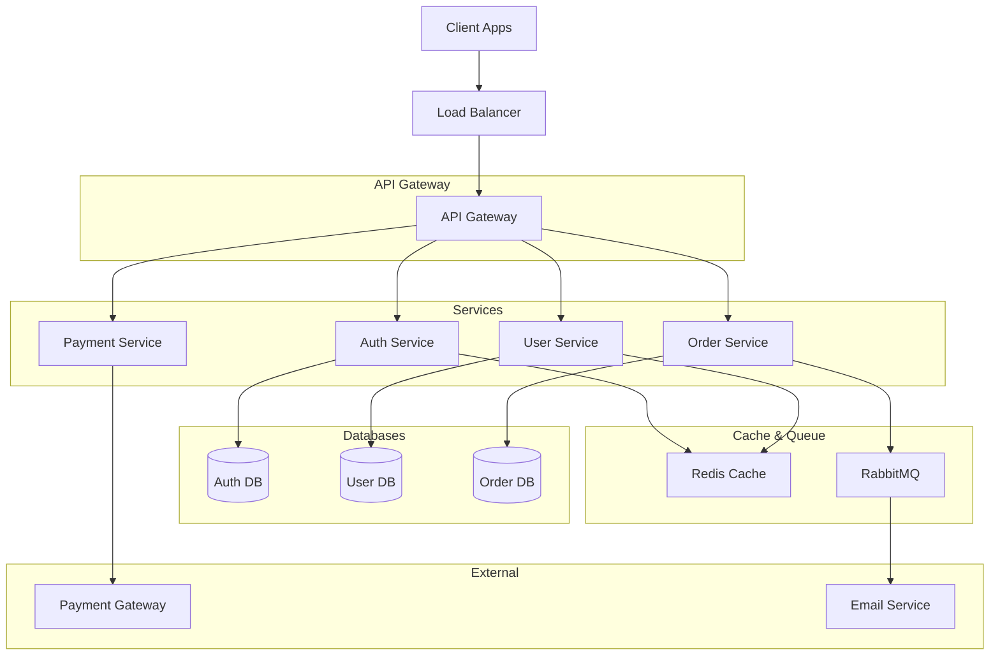

### Web Application Stack

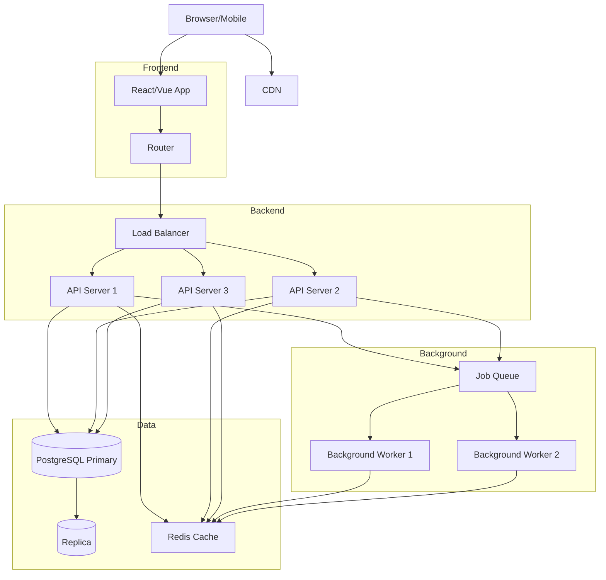

## 2. Mindmap

### Project Planning

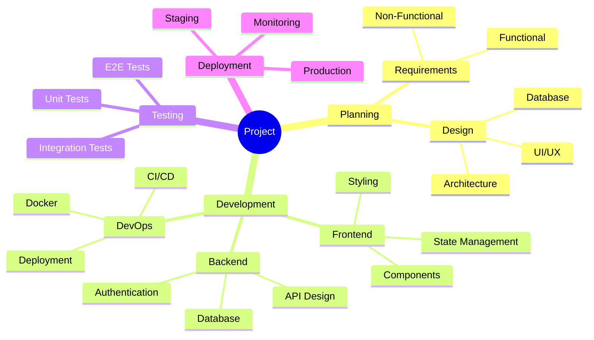

### Product Roadmap

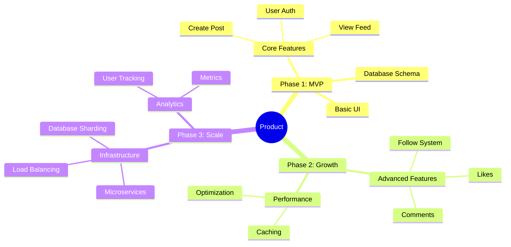

## 3. Timeline

### Release Timeline

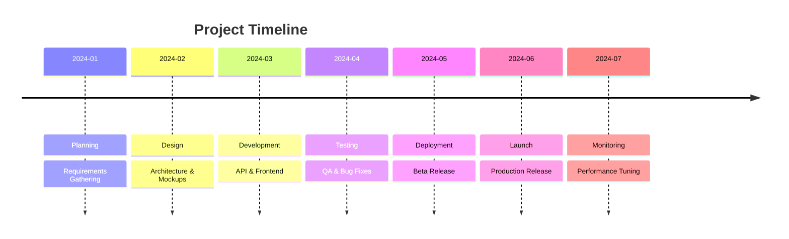

### Sprint Schedule

```mermaid
timeline
    title Sprint Schedule
    Sprint 1 : Setup : Development Environment
    Sprint 1 : : Project Structure
    Sprint 2 : API : Authentication Endpoints
    Sprint 2 : : User Management
    Sprint 3 : Frontend : Login/Register Pages
    Sprint 3 : : Dashboard Layout
    Sprint 4 : Testing : Unit Tests
    Sprint 4 : : Integration Tests
```

## 4. Git Graph

### Git Workflow (Feature Branch)

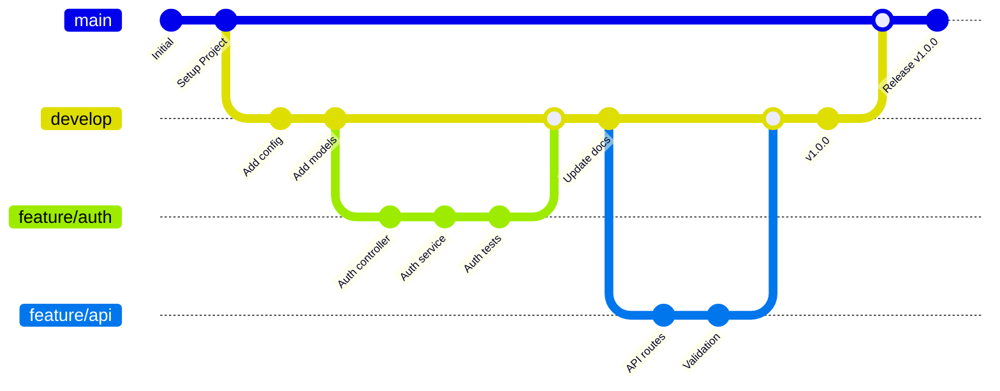

## 5. Pie Chart

### Market Share

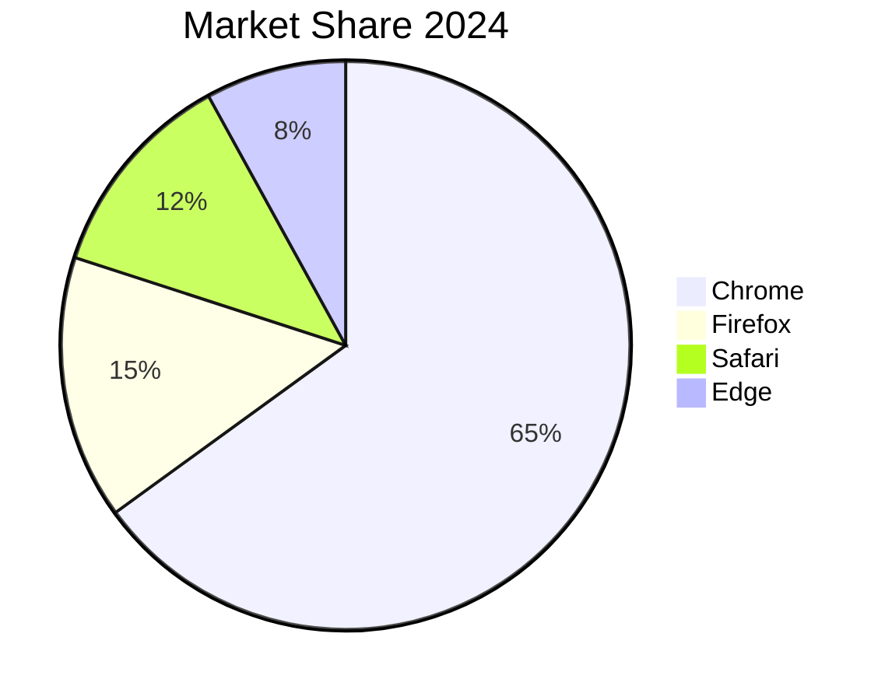

### Project Time Allocation

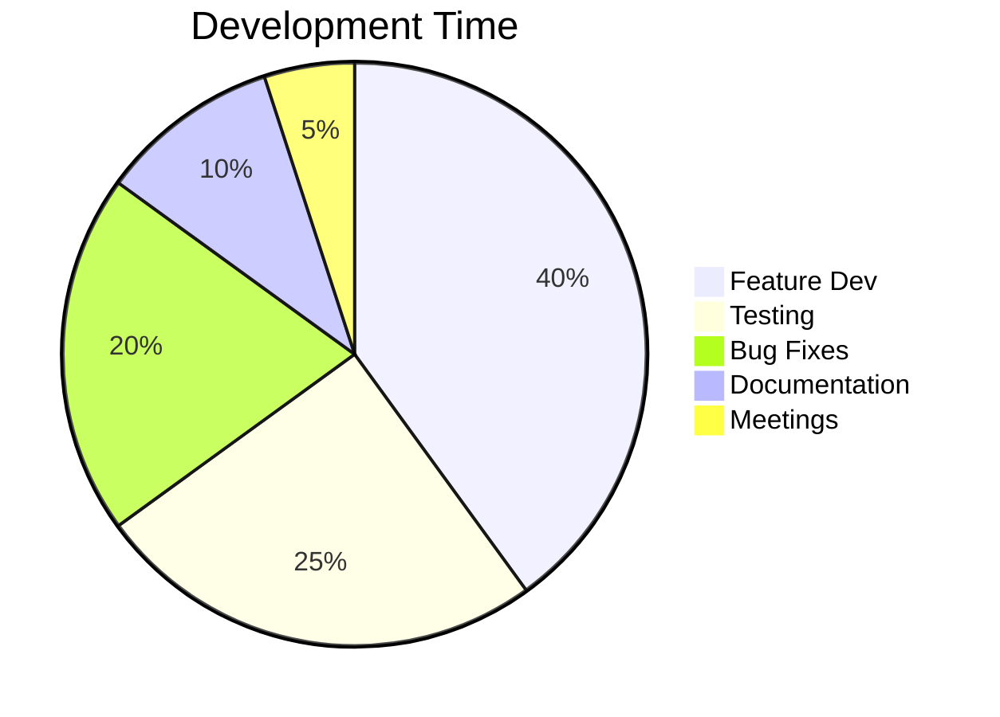

## 6. Gantt Chart (Advanced)

### Project Timeline

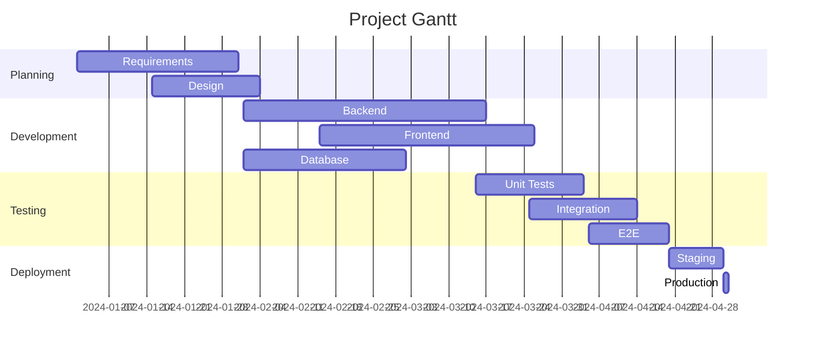

## 7. C4 Context Diagram

### System Context

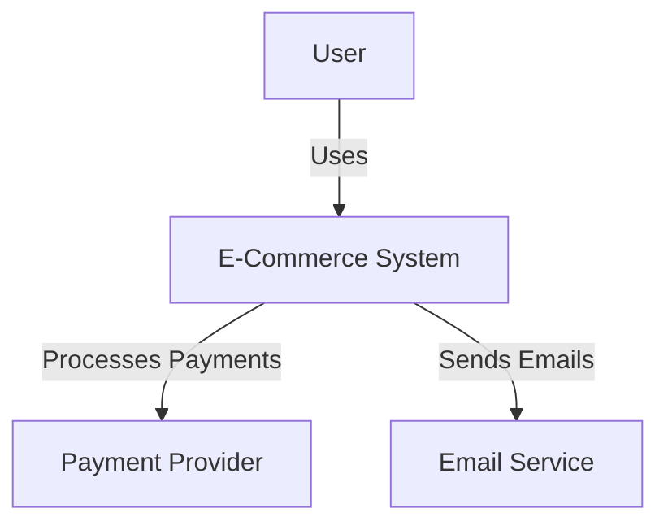

### Container Diagram

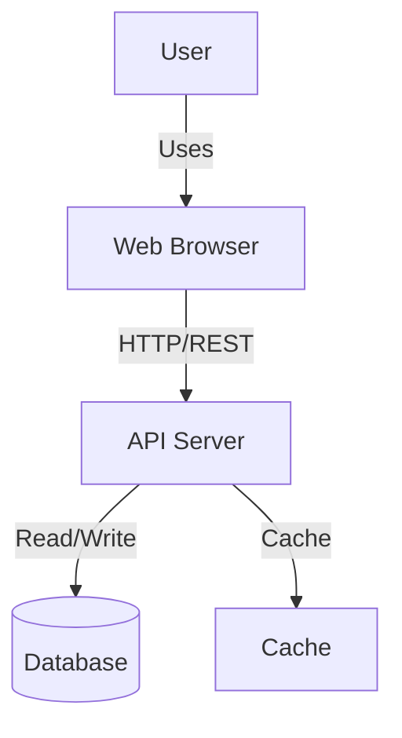

## 8. Complex State Machine

### Order Processing State Machine

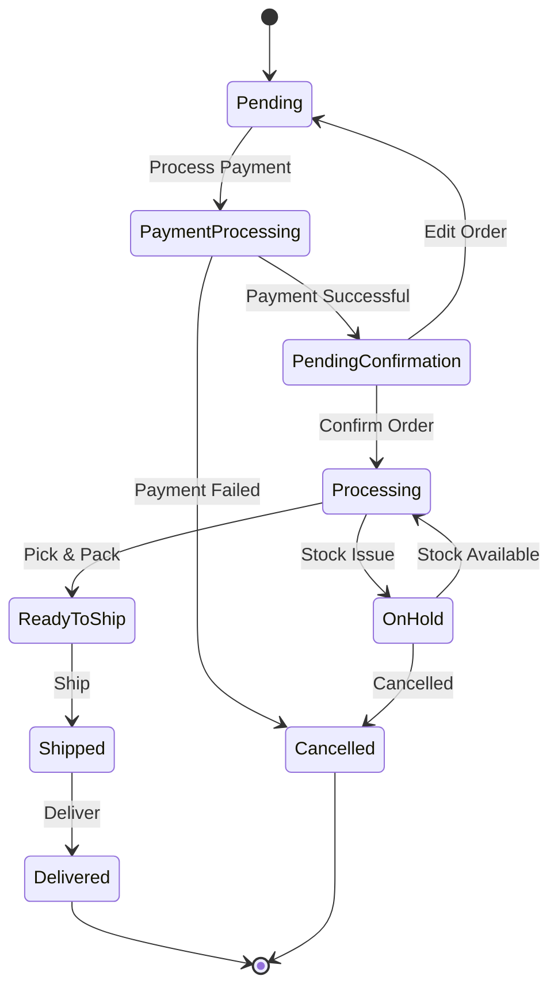

## Patterns

### System Integration Pattern

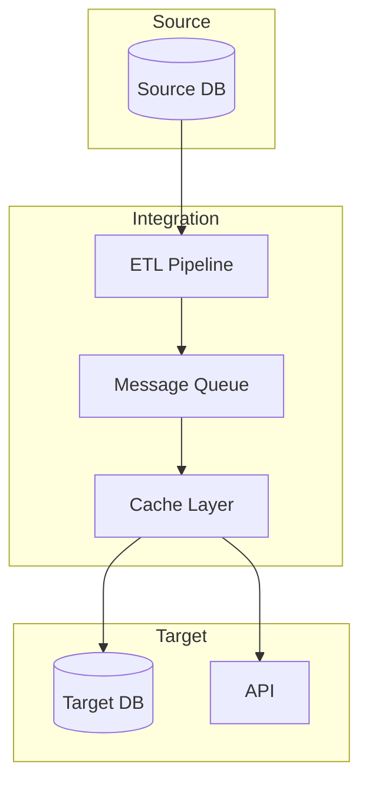

### Event-Driven Architecture

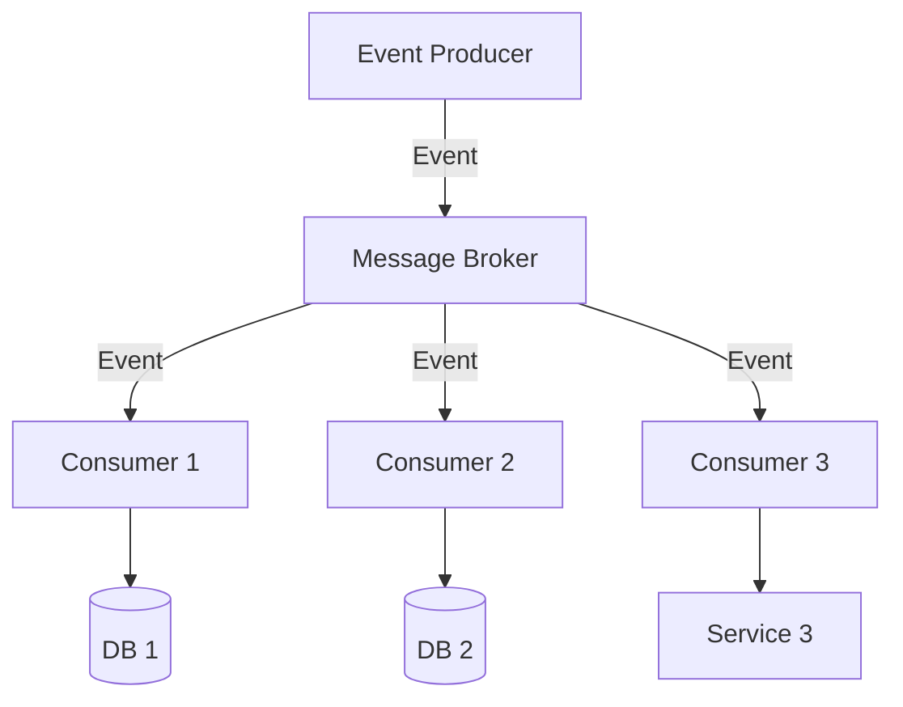

## Best Practices for Advanced Diagrams

1. **Use Subgraphs** — Group related components
2. **Color Code** — Distinguish layers/services
3. **Label Arrows** — Explain relationships
4. **Keep Balanced** — Avoid crowding
5. **Document Purpose** — Add titles/descriptions
6. **Version Control** — Track diagram changes
7. **Test Rendering** — Preview before sharing

## Performance Tips

- **Large diagrams** — Break into multiple diagrams
- **Many nodes** — Use zoom-friendly SVG format
- **Complex flows** — Consider splitting into sections
- **Readable** — Use 12pt+ font size in rendering

## Tools for Rendering

```bash
# Render with high quality
mmdc -i diagram.mmd -o diagram.png -s 2

# Render to SVG (vector, better for presentations)
mmdc -i diagram.mmd -o diagram.svg

# Render with custom config
mmdc -i diagram.mmd -o diagram.png -c config.json
```

---

**See [BEST_PRACTICES.md](BEST_PRACTICES.md) for optimization and styling.**
