# Basic Mermaid Diagrams

Start here. Flowcharts, sequences, and classes. Copy-paste examples.

## 1. Flowcharts

### Simple Linear Flow

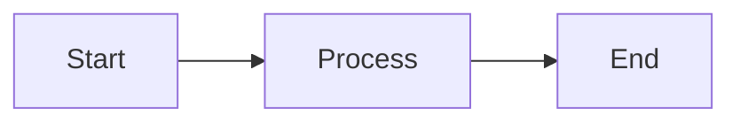

### Decision Tree

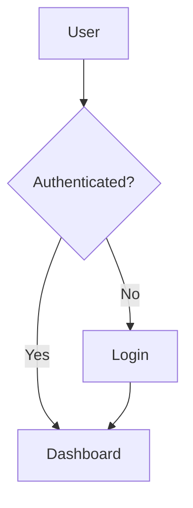

### Process with Loop

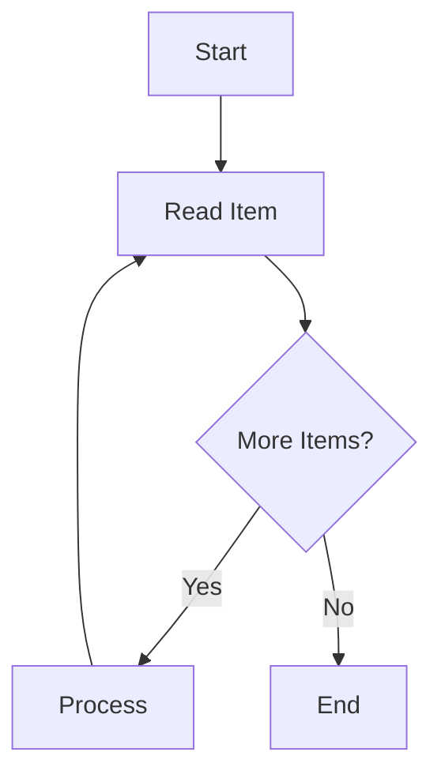

### API Request Flow

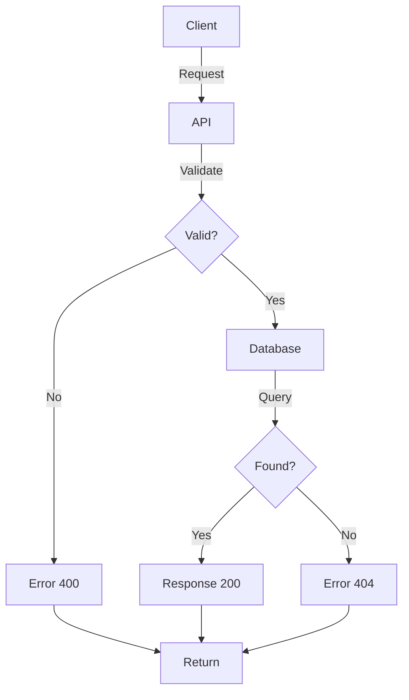

### Authentication Flow

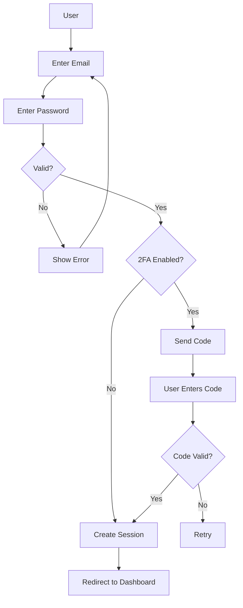

### Node Types

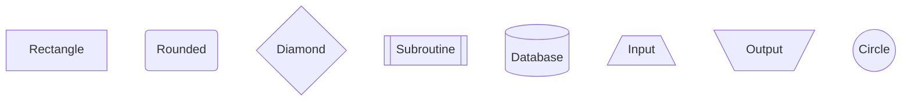

## 2. Sequence Diagrams

### Simple Request-Response

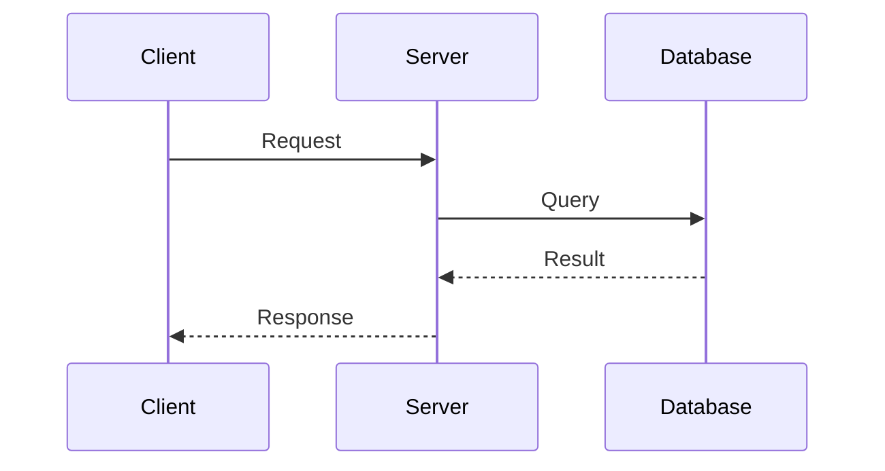

### Multiple Actors

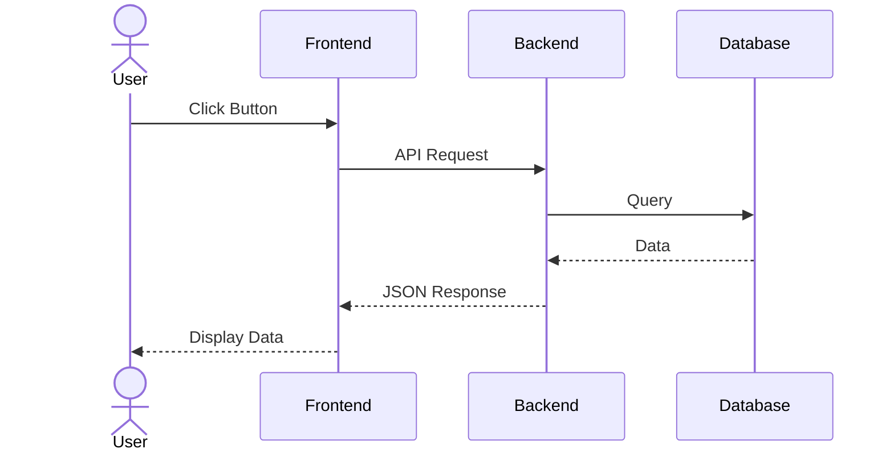

### Authentication Sequence

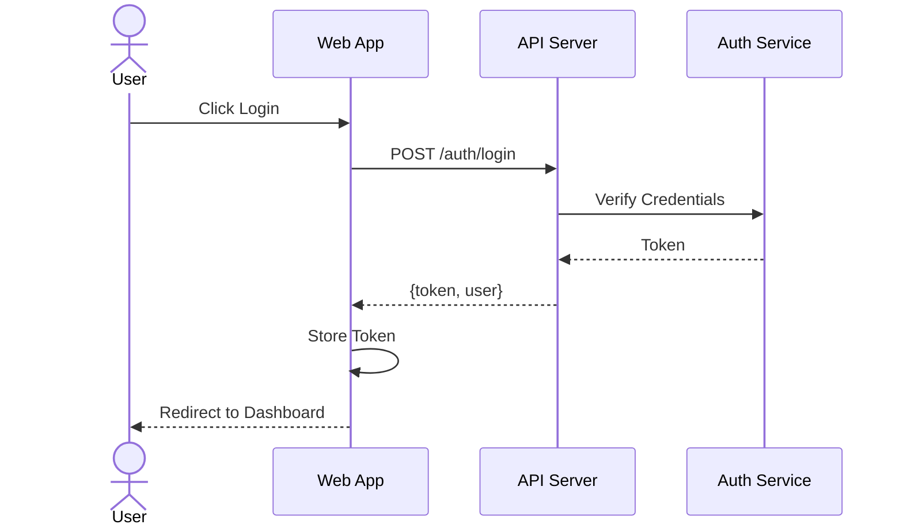

### Payment Processing

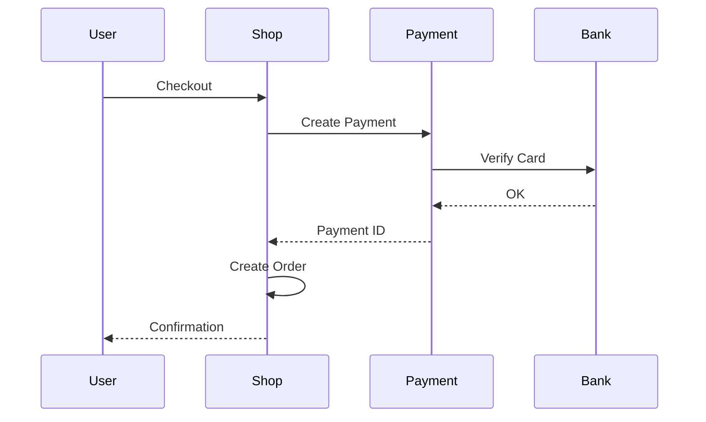

### Parallel Processing

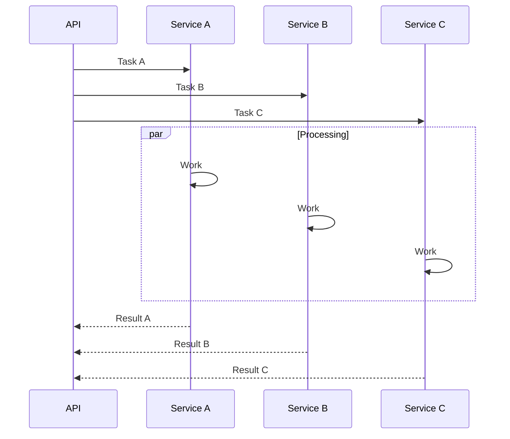

## 3. Class Diagrams

### User Class

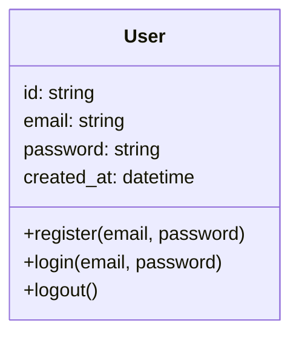

### Database Models

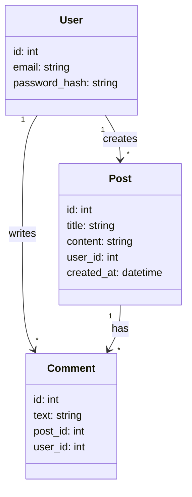

### E-commerce System

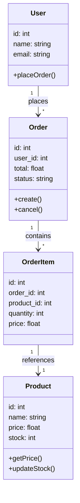

### Inheritance Hierarchy

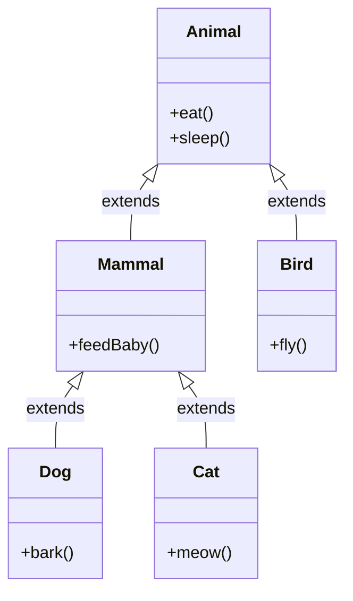

## 4. State Diagrams

### Simple State Machine

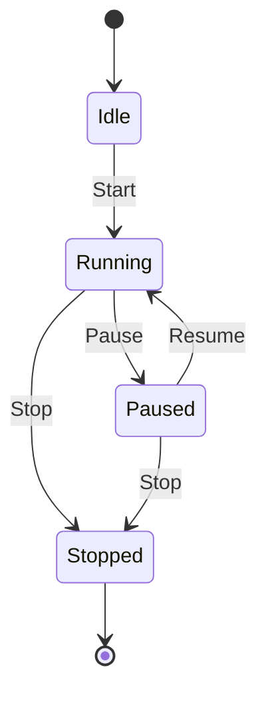

### User Authentication States

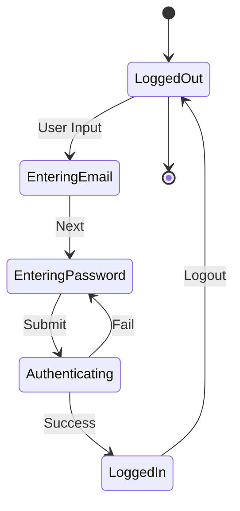

### Order Status Flow

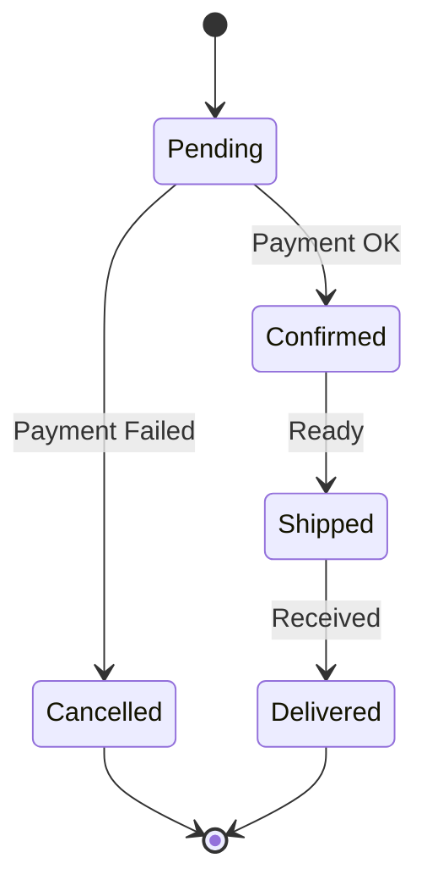

## 5. Entity-Relationship (ER) Diagram

### Simple Database Schema

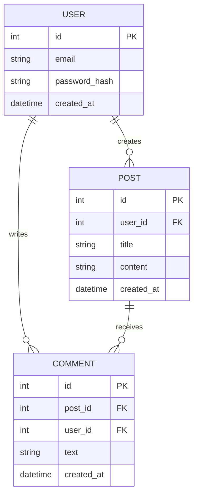

### E-commerce Database

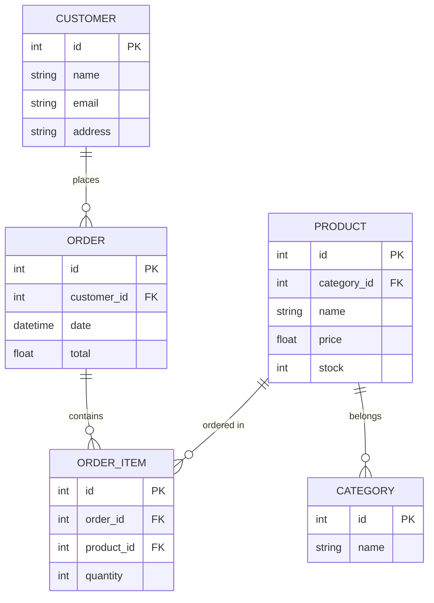

## Common Patterns

### Input Validation Pattern

```mermaid
flowchart TD
    A[Input] --> B{Valid?}
    B -->|No| C[Error Message]
    C --> A
    B -->|Yes| D[Process]
    D --> E[Success]
```

### API Endpoint Pattern

```mermaid
flowchart TD
    A[Request] --> B{Method?}
    B -->|GET| C[Retrieve]
    B -->|POST| D[Create]
    B -->|PUT| E[Update]
    B -->|DELETE| F[Delete]
    C --> G[Response]
    D --> G
    E --> G
    F --> G
```

### Error Handling Pattern

```mermaid
flowchart TD
    A[Try] --> B{Success?}
    B -->|Yes| C[Return Result]
    B -->|No| D[Catch Exception]
    D --> E{Recoverable?}
    E -->|Yes| F[Retry]
    E -->|No| G[Log Error]
    F --> B
    G --> H[Return Error]
    C --> I[End]
    H --> I
```

### Database Query Pattern

```mermaid
flowchart TD
    A[Query] --> B[Connect]
    B --> C[Execute]
    C --> D{Results?}
    D -->|Found| E[Map to Model]
    D -->|None| F[Empty Result]
    E --> G[Return]
    F --> G
    G --> H[Close Connection]
```

## Tips

1. **Use IDs** for nodes, not long labels
2. **Keep it simple** — max 15-20 nodes
3. **Use consistent naming** — camelCase or snake_case
4. **Group related items** — same direction flow
5. **Label arrows** — explain transitions
6. **Color strategically** — highlight important paths

## Next Steps

- Learn [INTERMEDIATE_DIAGRAMS.md](INTERMEDIATE_DIAGRAMS.md) for state machines, git graphs
- See [BEST_PRACTICES.md](BEST_PRACTICES.md) for optimization
- Use [CLI_REFERENCE.md](CLI_REFERENCE.md) for rendering
