# Mermaid Best Practices

Optimization, styling, performance, integration.

## 1. Readability

### Good: Clear, Simple, Readable

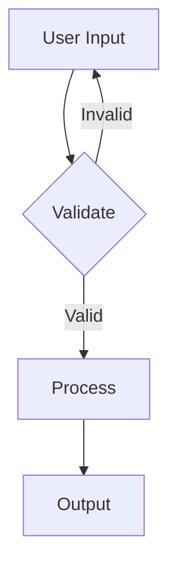

### Bad: Cluttered, Hard to Follow

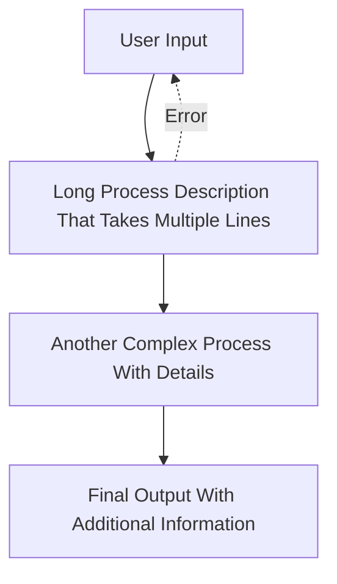

**Rules:**
- Max 15-20 nodes per diagram
- Use descriptive but short labels
- Clear directional flow
- Group related items

## 2. Styling & Colors

### Color by Category

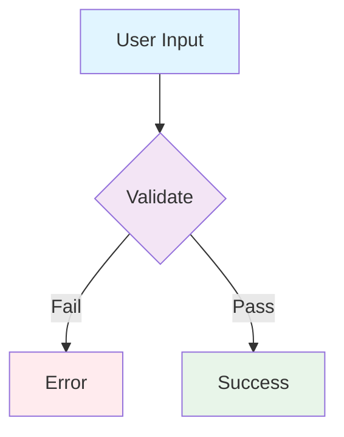

### Consistent Styling

```mermaid
flowchart TD
    A[Start]:::start
    B[Process 1]:::process
    C[Decision]:::decision
    D[Error]:::error
    E[End]:::end
    
    A --> B
    B --> C
    C -->|Fail| D
    C -->|Pass| E
    
    classDef start fill:#4CAF50,color:#fff
    classDef process fill:#2196F3,color:#fff
    classDef decision fill:#FF9800,color:#fff
    classDef error fill:#f44336,color:#fff
    classDef end fill:#9C27B0,color:#fff
```

## 3. Performance Optimization

### Break Large Diagrams

**Bad: One huge diagram (50+ nodes)**
```
Too complex, hard to understand, slow to render
```

**Good: Multiple focused diagrams**
```
1. System Context (5 nodes)
2. User Flow (8 nodes)
3. Data Flow (7 nodes)
4. Architecture (12 nodes)
```

### Use Direction Wisely

```mermaid
% LR = more compact
flowchart LR
    A[Start] --> B[Process] --> C[End]
```

```mermaid
% TD = better for long flows
flowchart TD
    A[Step 1]
    A --> B[Step 2]
    B --> C[Step 3]
    C --> D[Step 4]
    D --> E[Step 5]
```

## 4. Documentation Integration

### In GitHub README

```markdown
# System Architecture

```mermaid
graph TB
    Client[Client]
    API[API Server]
    DB[(Database)]
    
    Client --> API
    API --> DB
`​``

## 5. Version Control

### Store .mmd Files

```bash
# Good: Version control
diagrams/
├── user-flow.mmd
├── database-schema.mmd
├── api-architecture.mmd
└── deployment.mmd
```

### Generate Images in CI/CD

```yaml
# GitHub Actions
- name: Render Diagrams
  run: |
    mmdc -i diagrams/*.mmd -o diagrams/rendered/
    git add diagrams/rendered/
```

## 6. Naming Conventions

### Clear Node IDs

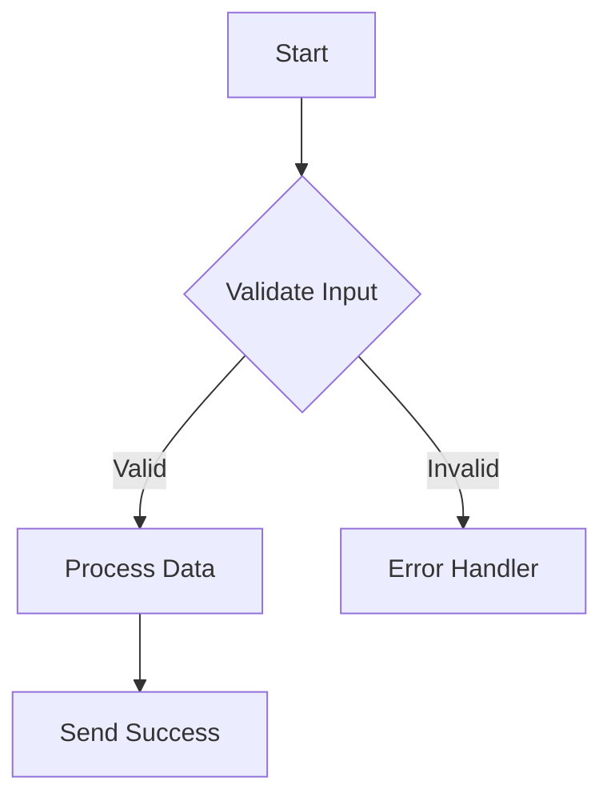

### Consistent Labels

```
% Good:
- CreateUser
- DeletePost
- CheckInventory

% Bad:
- make user
- get rid of post
- does warehouse have it?
```

## 7. Sequence Diagram Tips

### Manage Complexity

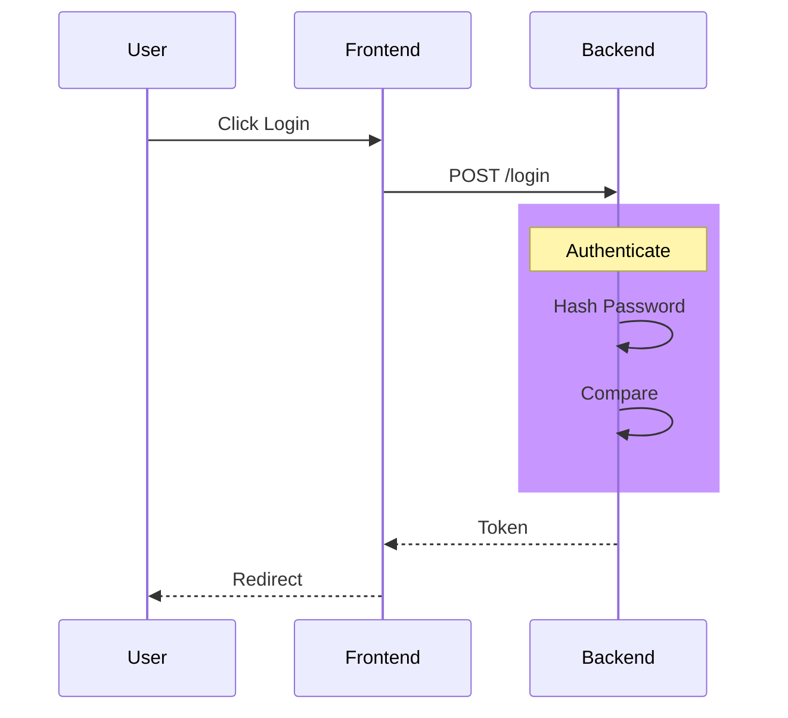

### Use Loops for Repetition

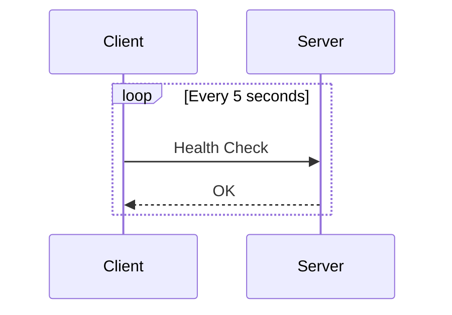

## 8. Class Diagram Best Practices

### Limit Inheritance Depth

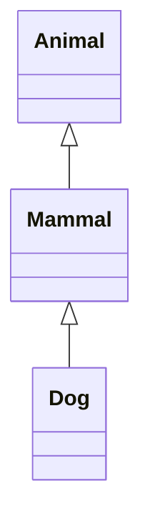

### Use Composition Over Deep Hierarchy

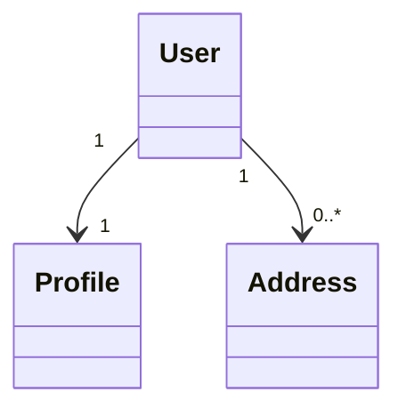

## 9. Testing Diagrams

### Syntax Validation

```bash
# Use online editor
https://mermaid.live

# Or CLI validation
mmdc -i diagram.mmd --configFile config.json
```

### Rendering Quality

```bash
# High quality SVG
mmdc -i diagram.mmd -o output.svg -t default

# PDF for printing
mmdc -i diagram.mmd -o output.pdf
```

## 10. Common Mistakes

### ❌ Too Much Information

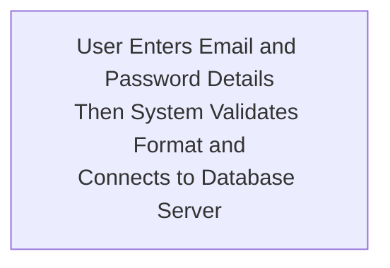

### ✅ Concise Labels

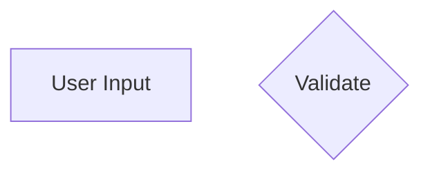

### ❌ Unclear Flow

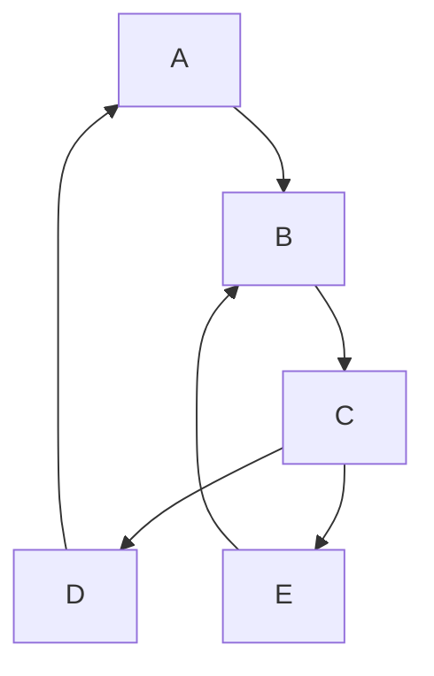

### ✅ Clear Structure

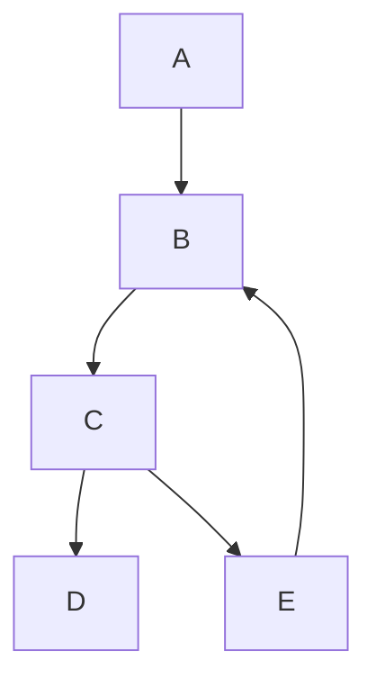

### ❌ Wrong Diagram Type

```
Using sequence diagram for process flow
Using flowchart for database relationships
Using class diagram for simple hierarchy
```

### ✅ Right Choice

```
Process flow → Flowchart
Communication → Sequence
Database → ER Diagram
State changes → State Diagram
```

## 11. Accessibility

### Add Descriptions

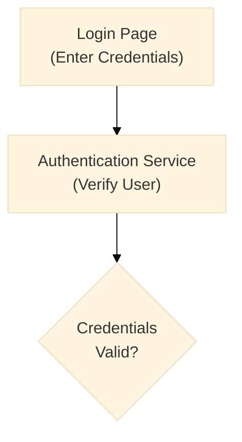

### Use Alt Text

```markdown

*Diagram: User login flow with credential validation*
```

## 12. Performance Monitoring

### Rendering Time

```bash
# Time rendering
time mmdc -i large-diagram.mmd -o output.png

# Profile with custom config
mmdc -i diagram.mmd -o output.png -c optimize.json
```

### Optimization Config

```json
{
  "flowchart": {
    "htmlLabels": true,
    "useMaxWidth": true
  },
  "sequence": {
    "messageAlign": "center"
  }
}
```

## Checklist

Before publishing:

- [ ] Diagram is clear (max 20 nodes)
- [ ] Labels are concise and meaningful
- [ ] Colors are consistent
- [ ] Direction is consistent (TD/LR)
- [ ] No loops or unclear flows
- [ ] Tested in renderer
- [ ] Renders to PNG/SVG correctly
- [ ] Fits page when printed
- [ ] Documentation complete
- [ ] In version control

## Resources

- [Mermaid Config](https://mermaid.js.org/config/configuration.html)
- [Styling Guide](https://mermaid.js.org/syntax/flowchart.html#styling-and-classes)
- [Theme Options](https://mermaid.js.org/syntax/flowchart.html#theme-variables)
