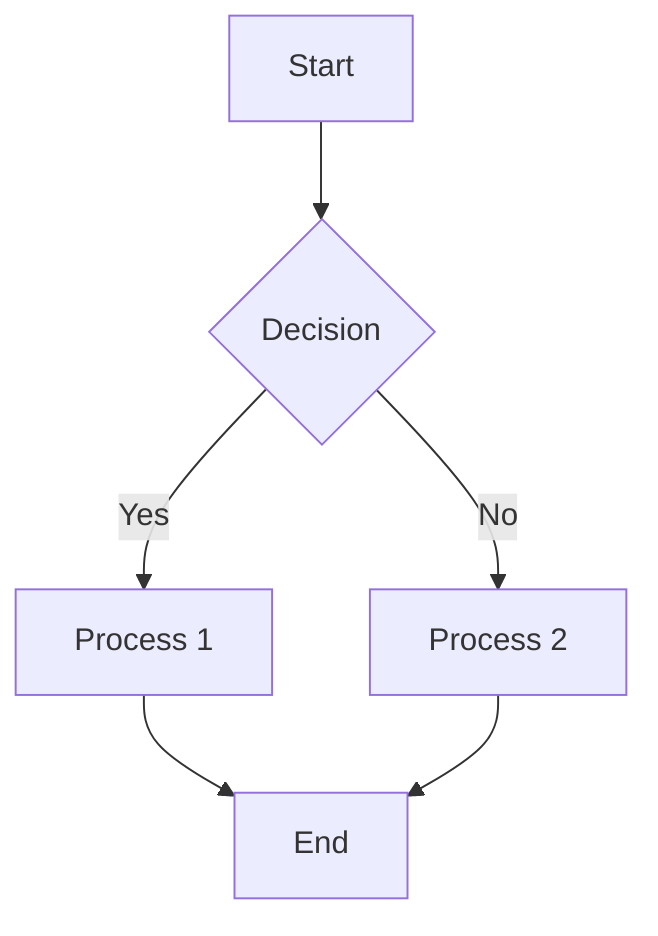

# Mermaid Diagram Skill

Professional diagramming with Mermaid: flowcharts, sequences, states, architectures, and more. From basic to complex.

## What's Included

### 📚 Documentation

1. **BASIC_DIAGRAMS.md** — Flowcharts, sequence diagrams, class diagrams (60+ examples)
2. **INTERMEDIATE_DIAGRAMS.md** — State, ER, git graph, gantt charts (40+ examples)
3. **ADVANCED_DIAGRAMS.md** — Architecture, mindmaps, timelines, pie charts (30+ examples)
4. **BEST_PRACTICES.md** — Performance, readability, styling, integration
5. **CLI_REFERENCE.md** — Rendering, conversion, automation

### 🛠️ Tools

- **CLI renderer** — Convert .mmd files to PNG/SVG/PDF
- **VSCode integration** — Preview diagrams in editor
- **Templates** — Copy-paste starting points
- **Examples** — Real-world use cases

### 📦 Diagram Types (12 Total)

| Type | Use |
|------|-----|
| **Flowchart** | Algorithms, processes, logic |
| **Sequence** | Communication, workflows |
| **Class** | OOP, data models |
| **State** | State machines, workflows |
| **ER** | Database schemas |
| **Git Graph** | Git workflows, branching |
| **Gantt** | Project timelines |
| **Mindmap** | Brainstorming, planning |
| **Timeline** | Historical events |
| **Architecture** | System design |
| **C4** | Context diagrams |
| **Pie Chart** | Data distribution |

## Quick Start

### Installation

```bash
# Install Mermaid CLI
npm install -g @mermaid-js/mermaid-cli

# Or use Docker
docker run --rm -v /path/to/diagrams:/data minlag/mermaid-cli
```

### Create Diagram



### Render to Image

```bash
mmdc -i diagram.mmd -o diagram.png
```

## Diagram Type Comparison

| Type | Complexity | Learning Curve | Use Frequency |
|------|-----------|-----------------|---------------|
| Flowchart | ⭐⭐ | Easy | Very High |
| Sequence | ⭐⭐⭐ | Medium | High |
| Class | ⭐⭐⭐⭐ | Hard | Medium |
| State | ⭐⭐ | Easy | High |
| ER | ⭐⭐⭐ | Medium | High |
| Git Graph | ⭐ | Very Easy | Medium |
| Gantt | ⭐⭐ | Easy | Medium |
| Mindmap | ⭐ | Very Easy | Medium |
| Timeline | ⭐⭐ | Easy | Low |
| Architecture | ⭐⭐⭐⭐⭐ | Very Hard | High |
| C4 | ⭐⭐⭐⭐ | Hard | Medium |
| Pie Chart | ⭐ | Very Easy | Low |

## Common Use Cases

### Software Engineering

**System Design:**
```
Architecture Diagram → Shows microservices, databases, queues
C4 Diagram → Context, containers, components, code
```

**Database Design:**
```
ER Diagram → Tables, relationships, constraints
```

**Workflow:**
```
Flowchart → Business process, algorithm logic
State Diagram → User flows, authentication
Sequence Diagram → API calls, message passing
```

**Project Management:**
```
Gantt Chart → Timeline, milestones, dependencies
Mindmap → Planning, requirements, breakdown
```

### Documentation

**API Documentation:**
```
Sequence Diagram → Request-response flow
Class Diagram → Data models
```

**Architecture Documentation:**
```
Architecture Diagram → High-level system
C4 Diagram → Detailed layers
```

**Process Documentation:**
```
Flowchart → Step-by-step process
Sequence Diagram → Multi-actor interaction
```

## Integration Points

### GitHub/GitLab

Embed in README.md:
```markdown
```mermaid
flowchart LR
    A[Start] --> B[End]
`​``
```

### Confluence

Use Mermaid plugin:
```
[Mermaid Diagram]
{mermaid
flowchart TD
    A --> B
}
```

### VSCode

Install extension:
```
Mermaid Preview
Markdown Preview Mermaid Support
```

### Notion

Use embed:
```
/embed https://mermaid.live/...
```

### Obsidian

Native support:
````markdown
```mermaid
...diagram...
```
````

## Best Practices

### 1. Keep Diagrams Simple
- Max 20 nodes in flowchart
- Max 8 actors in sequence
- Group related items

### 2. Use Consistent Naming
- CamelCase for nodes
- snake_case for IDs
- Clear labels

### 3. Optimize Performance
- Avoid long labels
- Use node IDs, not inline text
- Batch similar elements

### 4. Styling & Readability
- Use color for grouping
- Consistent arrow types
- Proper spacing

### 5. Version Control
- Store .mmd files in git
- Link to rendered images
- Document diagram purpose

## File Structure

```
mermaid-diagrams/
├── README.md                 # This file
├── BASIC_DIAGRAMS.md        # Simple to intermediate
├── INTERMEDIATE_DIAGRAMS.md # Medium complexity
├── ADVANCED_DIAGRAMS.md     # Complex patterns
├── BEST_PRACTICES.md        # Optimization & patterns
├── CLI_REFERENCE.md         # Tools & automation
├── examples/
│   ├── flowchart/
│   ├── sequence/
│   ├── architecture/
│   ├── database/
│   └── project/
├── templates/
│   ├── api_flow.mmd
│   ├── microservices.mmd
│   ├── user_flow.mmd
│   └── database_schema.mmd
└── tools/
    ├── render.sh           # Batch render to PNG
    ├── optimize.js         # Optimize diagram syntax
    └── validate.js         # Check syntax
```

## Tutorial Path

### Day 1: Basics
- [ ] Read BASIC_DIAGRAMS.md
- [ ] Create 3 flowcharts
- [ ] Create 1 sequence diagram
- [ ] Render to PNG

### Day 2: Intermediate
- [ ] Read INTERMEDIATE_DIAGRAMS.md
- [ ] Create 1 class diagram
- [ ] Create 1 state diagram
- [ ] Create 1 ER diagram

### Day 3: Advanced
- [ ] Read ADVANCED_DIAGRAMS.md
- [ ] Create 1 architecture diagram
- [ ] Create 1 mindmap
- [ ] Style & optimize

### Week 2+: Integration
- [ ] Use in documentation
- [ ] Set up CI/CD rendering
- [ ] Create reusable templates
- [ ] Share with team

## Resources

### Official
- [Mermaid Docs](https://mermaid.js.org)
- [Mermaid Live Editor](https://mermaid.live)
- [Mermaid CLI](https://github.com/mermaid-js/mermaid-cli)

### Community
- [Mermaid Examples](https://github.com/mermaid-js/mermaid/tree/develop/demos)
- [Awesome Mermaid](https://github.com/mermaid-js/awesome-mermaid)

## Quick Reference

### Basic Syntax

```mermaid
% Flowchart
flowchart TD
    A --> B

% Sequence
sequenceDiagram
    A ->> B: Message

% State
stateDiagram-v2
    [*] --> State1

% Class
classDiagram
    class ClassName
```

### Rendering

```bash
# PNG (default)
mmdc -i diagram.mmd -o diagram.png

# SVG (vector)
mmdc -i diagram.mmd -o diagram.svg -t default

# PDF (print)
mmdc -i diagram.mmd -o diagram.pdf

# Watch mode
mmdc -w -i diagram.mmd -o diagram.png
```

## Next Steps

1. **Read** appropriate level documentation (BASIC/INTERMEDIATE/ADVANCED)
2. **Copy** template that matches your use case
3. **Modify** for your specific needs
4. **Render** to PNG/SVG
5. **Integrate** into documentation
6. **Share** with team

---

**Start with BASIC_DIAGRAMS.md** for step-by-step examples.
